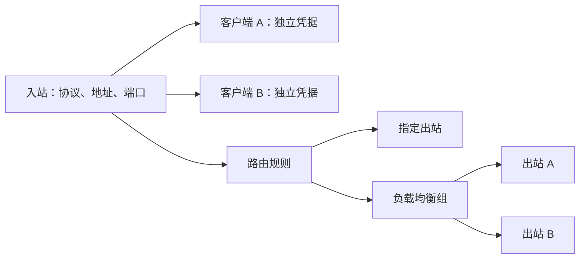

# 入站、客户端与网络配置设计

本次将终端脚本改成与 3x-ui 相同的“入站包含客户端”管理方式。脚本仍使用中文终端菜单，不安装 Web 面板。

## 对象关系

一个入站负责监听端口、协议、加密方式、Reality 传输设置和公网地址。客户端归属于一个入站，负责自己的 UUID、密码或代理账号。同一入站的客户端共用服务器地址和端口，各自导出链接及客户端出站 JSON。



“客户端出站 JSON”是给连接这台服务器的设备导入的配置。“服务器出站设置”则决定这台服务器把代理流量发送到哪里，由独立的管理菜单配置。

## 当前菜单

```text
主菜单
  1 快速创建节点
      选择协议和网络环境
      自动创建入站 + 首个客户端 → 显示链接
  2 查看节点 / 复制链接
      按入站 → 客户端 → 连接信息 / 出站 JSON
      批量导出全部启用客户端的链接
  3 入站与客户端总览
      入站开关、协议、端口、启用/全部客户端数
      展开每个入站的客户端名称与开关
  4 入站与客户端管理
      入站详情
      客户端管理 → 添加 / 查看 / 导出 / 启停 / 改名 / 删除
      本机监听端口
      公网地址 / DDNS / NAT 映射
      整个入站的启停
      删除入站及其客户端
  5 服务器出站：导入链接 / JSON、管理、测试
  6 路由规则：向导、排序、默认出口、检查、嗅探、恢复
  7 负载均衡：成员、策略、健康探测、回退
  8 服务管理
  9 高级设置
      1 自定义创建：先保存入站，再添加客户端
          监听端口（自动 / 手动）→ 可选公网端口 → 域名 → 可选 DDNS
      2 内核版本
      3 DDNS
      4 系统检测
      5 卸载
```

查看总览不会输出密码或 UUID。进入指定客户端才显示完整凭据；批量导出只包含启用入站中的启用客户端。配置开关与服务运行状态分别显示，启用不代表服务必然正在运行。

自定义创建支持只保存入站，在“添加客户端”的名称提示输入 `0` 即可稍后添加。空入站、停用入站，以及没有启用客户端的入站不会写入 Xray 运行配置，因此不会监听端口。保存的监听端口仍被脚本保留，避免另一个入站占用。

自定义创建直接询问需要设置的参数，不再要求选择公网、NAT 或 DDNS 网络类型。端口默认自动选择；若公网连接端口与监听端口不同，单独保存映射。连接地址可自动检测公网 IP 或使用域名，填写域名后按需设置已有 DDNS、Cloudflare 或 DuckDNS 更新方式。

## 协议能力

| 协议 / 模式 | 一个入站的客户端数量 | 凭据 |
| --- | --- | --- |
| 普通 SS 的四种 AEAD 加密 | 多个 | 每客户端独立密码 |
| 新建 SS2022 AES128 / AES256 | 多个 | 入站服务端密钥 + 独立客户端密钥 |
| SS2022 ChaCha20 | 一个 | 独立密钥 |
| 旧版单密码 SS2022 | 一个 | 保留原始密钥和链接格式 |
| VLESS + Reality | 多个 | 独立 UUID，共用入站 Reality 密钥和伪装站点 |
| SOCKS5 / HTTP | 多个 | 独立账号密码 |

SS2022 AES 多客户端的分享密码必须是 `服务端密钥:客户端密钥`。脚本在链接和出站 JSON 中自动组合；停用、删除某个客户端不会轮换入站密钥或其他客户端凭据。旧版单密码 SS2022 不自动转换为多用户模式，避免原客户端失效；需要多个客户端时创建新的 AES 入站。

## 存储与应用

`/etc/xray-ss/inbounds.json` 是入站和客户端的管理数据，包含版本号及稳定 ID。每个入站保存 `tag`、`enabled`、`mode`、协议模板 `config` 和客户端数组 `clients`；每个客户端保存 `key`、`name`、`enabled` 和原生协议凭据 `account`。新客户端的身份 ID 与名称分开，改名不会改变凭据或客户端 ID。

`node-hosts.json` 和 `node-meta.json` 继续按入站标签保存公网地址、NAT 映射及 Reality 公钥，兼容原有备份。`config.json` 是 Xray 实际运行的配置，由启用入站和启用客户端生成。未纳入管理的原生入站，以及原有 DNS、路由、出站、负载均衡设置会保留。

首次升级时备份原配置，再将已有节点导入为入站及客户端。迁移本身不改运行配置、端口、地址或凭据。修改入站和客户端前保存管理数据与运行配置快照；生成配置通过 Xray 校验并成功启动后，才保存新的管理数据。校验或启动失败时恢复原配置，管理数据不提交。

备份和恢复应保存完整的 `/etc/xray-ss`，包括 `inbounds.json`、`network.json`、运行配置、地址和元数据；不要只恢复 `config.json`。后续编辑受管入站应通过脚本完成，避免运行配置与管理数据不一致。

## 出站、路由与负载均衡

`network.json` 的管理数据包含 `outbounds`、`rules`、`balancers`、`routing`、`default`、`probe`，并保留原有 observatory / burstObservatory 设置。出站和均衡组用原生 tag 建立引用，显示名称独立；规则用稳定 key 排序并保留完整原生配置。首次导入现有运行配置时不改流量行为。

出站由链接或 JSON 解析而来，导入阶段不执行粘贴内容、不自动访问远程订阅。支持 SS、SS2022、VLESS 的 TCP/WS/gRPC/HTTPUpgrade/XHTTP、TLS/Reality，以及 SOCKS/HTTP(S) 链接。其他协议和链接选项可通过原生 JSON 导入，由当前 Xray 内核决定是否兼容。重名出站分配新标签，同时改写本批出站内的 dialerProxy / proxySettings 引用。

入站与出站之间不做协议配对限制，路由通过标签连接二者。SS 入站可以使用 VMess、Trojan 等任意当前内核支持的出站；均衡组成员也可使用不同协议。

运行配置由启用出站、启用规则和启用均衡组生成；最后补一条默认出口规则，支持指定出站或均衡组。原有 DNS、入站和其他顶层配置保留。修改入站也会保留生成的网络设置；网络备份包含入站、地址和客户端数据，但网络恢复只恢复网络模块，再校验当前入站引用。

规则向导提供来源入站、可识别的客户端 email、目标域名/IP/端口/网络和去向。原生 JSON 可设置更多内核支持的条件。检查涵盖缺失引用、停用目标、重复规则和前置全匹配规则；最终始终调用内核校验。GeoIP/GeoSite 数据库由用户准备，未安装时内核校验会拒绝相应规则。

均衡策略为 random、roundRobin、leastPing。Xray 的 selector 使用标签前缀，因此编译前检查实际匹配集合必须等于用户选择的成员集合。最低延迟和 fallback 会为成员自动生成健康探测，普通随机和轮询组可不启用探测。现有观测配置保留并补齐所需成员；健康探测使用内核后台任务，无额外常驻管理进程。

启用规则、默认出口和均衡组成员必须引用启用的目标。删除操作检查全部规则（包括停用规则）、均衡组和出站链依赖，避免稍后启用配置时引用失效。直连出站受保护。修改先生成候选配置并备份，通过校验及服务重启后提交管理数据；失败时恢复配置和原服务状态。

## 验证方式

`tests/inbounds.sh` 使用真实 Xray 内核校验配置，用隔离的服务钩子验证管理状态、迁移和失败回滚。`tests/integration.sh` 在临时目录启动真实 Xray 服务端和客户端，验证多客户端的 TCP/UDP、IPv6、停用后的认证拒绝，以及 Reality 的实际 HTTPS 自检。两者均不覆盖系统的 Xray 配置或服务。

```bash
XRAY_TEST_CORE=/usr/local/bin/xray-ss-core bash tests/inbounds.sh
XRAY_TEST_CORE=/usr/local/bin/xray-ss-core bash tests/integration.sh
XRAY_TEST_CORE=/usr/local/bin/xray-ss-core bash tests/network.sh
XRAY_TEST_CORE=/usr/local/bin/xray-ss-core python3 tests/network-integration.py
```

`tests/network.sh` 验证导入、引用、排序、配置校验和失败回滚。`tests/network-integration.py` 使用 30303–30310 端口运行真实代理链，覆盖 SS 入站转发到不同协议、客户端身份分流、均衡和故障恢复；VMess/Trojan 测试上游只监听临时回环端口。使用 `--keep-for-external` 可保留服务供另一台机器运行 `tests/network-external.py`，其参数说明见 `--help`；测试完成后自动停止临时进程。
