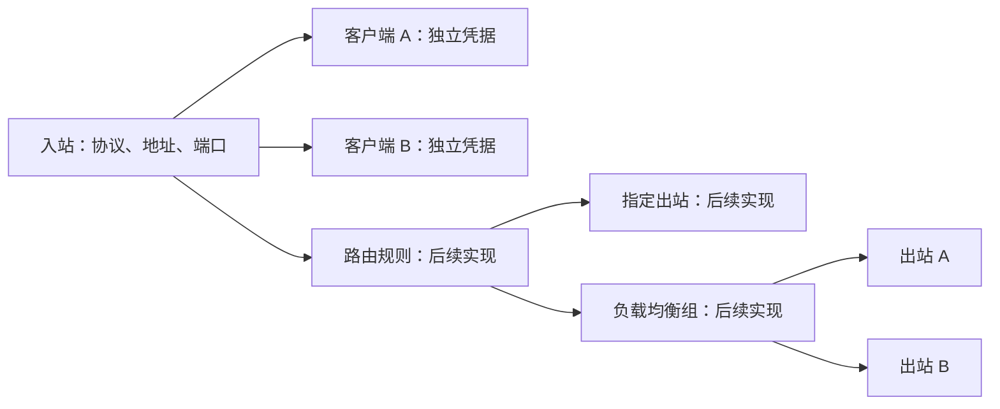

# 入站、客户端与后续配置设计

本次将终端脚本改成与 3x-ui 相同的“入站包含客户端”管理方式。脚本仍使用中文终端菜单，不安装 Web 面板。

## 对象关系

一个入站负责监听端口、协议、加密方式、Reality 传输设置和公网地址。客户端归属于一个入站，负责自己的 UUID、密码或代理账号。同一入站的客户端共用服务器地址和端口，各自导出链接及客户端出站 JSON。



“客户端出站 JSON”是给连接这台服务器的设备导入的配置。“服务器出站设置”则决定这台服务器把代理流量发送到哪里，是后续独立的管理模块。

## 当前菜单

```text
主菜单
  1 快速创建节点
      选择协议和网络环境
      自动创建入站 + 首个客户端 → 显示链接
  2 查看节点 / 复制链接
      按入站 → 客户端 → 连接信息 / 出站 JSON
      批量导出全部启用客户端的链接
  3 入站与客户端总览
      入站开关、协议、端口、启用/全部客户端数
      展开每个入站的客户端名称与开关
  4 入站与客户端管理
      入站详情
      客户端管理 → 添加 / 查看 / 导出 / 启停 / 改名 / 删除
      本机监听端口
      公网地址 / DDNS / NAT 映射
      整个入站的启停
      删除入站及其客户端
  5 服务管理
  6 高级设置
      1 自定义创建：先保存入站，再添加客户端
      2 内核版本
      3 DDNS
      4 系统检测
      5 卸载
```

查看总览不会输出密码或 UUID。进入指定客户端才显示完整凭据；批量导出只包含启用入站中的启用客户端。配置开关与服务运行状态分别显示，启用不代表服务必然正在运行。

自定义创建支持只保存入站，在“添加客户端”的名称提示输入 `0` 即可稍后添加。空入站、停用入站，以及没有启用客户端的入站不会写入 Xray 运行配置，因此不会监听端口。保存的监听端口仍被脚本保留，避免另一个入站占用。

## 协议能力

| 协议 / 模式 | 一个入站的客户端数量 | 凭据 |
| --- | --- | --- |
| 普通 SS 的四种 AEAD 加密 | 多个 | 每客户端独立密码 |
| 新建 SS2022 AES128 / AES256 | 多个 | 入站服务端密钥 + 独立客户端密钥 |
| SS2022 ChaCha20 | 一个 | 独立密钥 |
| 旧版单密码 SS2022 | 一个 | 保留原始密钥和链接格式 |
| VLESS + Reality | 多个 | 独立 UUID，共用入站 Reality 密钥和伪装站点 |
| SOCKS5 / HTTP | 多个 | 独立账号密码 |

SS2022 AES 多客户端的分享密码必须是 `服务端密钥:客户端密钥`。脚本在链接和出站 JSON 中自动组合；停用、删除某个客户端不会轮换入站密钥或其他客户端凭据。旧版单密码 SS2022 不自动转换为多用户模式，避免原客户端失效；需要多个客户端时创建新的 AES 入站。

## 存储与应用

`/etc/xray-ss/inbounds.json` 是入站和客户端的管理数据，包含版本号及稳定 ID。每个入站保存 `tag`、`enabled`、`mode`、协议模板 `config` 和客户端数组 `clients`；每个客户端保存 `key`、`name`、`enabled` 和原生协议凭据 `account`。新客户端的身份 ID 与名称分开，改名不会改变凭据或客户端 ID。

`node-hosts.json` 和 `node-meta.json` 继续按入站标签保存公网地址、NAT 映射及 Reality 公钥，兼容原有备份。`config.json` 是 Xray 实际运行的配置，由启用入站和启用客户端生成。未纳入管理的原生入站，以及原有 DNS、路由、出站、负载均衡设置会保留。

首次升级时备份原配置，再将已有节点导入为入站及客户端。迁移本身不改运行配置、端口、地址或凭据。修改入站和客户端前保存管理数据与运行配置快照；生成配置通过 Xray 校验并成功启动后，才保存新的管理数据。校验或启动失败时恢复原配置，管理数据不提交。

备份和恢复应保存完整的 `/etc/xray-ss`，包括 `inbounds.json`、运行配置、地址和元数据；不要只恢复 `config.json`。后续编辑受管入站应通过脚本完成，避免运行配置与管理数据不一致。

## 后续配置模块

以下是后续实现方案，当前没有对应的交互式编辑器。现有手工设置会在入站和客户端操作时保留。

| 模块 | 主要字段与操作 | 约束 |
| --- | --- | --- |
| 服务器出站 | 稳定 tag、名称、协议、连接参数、启停、连通测试 | 默认 direct 保留；被规则或均衡组引用时先解除引用再删除 |
| 路由规则 | 名称、开关、顺序、来源入站、域名/IP/端口/网络、目标 | 目标在 outboundTag 与 balancerTag 中二选一；按顺序匹配 |
| 负载均衡 | 稳定 tag、成员出站、策略、探测地址、探测周期、回退出站 | 成员必须有效；停用或删除前检查引用；探测能力与内核版本一起校验 |

后续主菜单增加“路由规则”“服务器出站”“负载均衡”三个独立入口。每个入口沿用“列表 → 详情 → 新建/修改/排序/启停/删除”的操作方式，与入站和客户端管理保持一致。

流量流程为：接收入站 → 校验客户端 → 按顺序匹配路由 → 指定出站或均衡组 → 目标。规则以稳定标签建立引用，显示名称可以更改。支持原生 email 身份的协议可后续增加按客户端匹配；代理账号协议的能力应以 Xray 实际支持为准。

实现顺序建议为服务器出站、路由规则、负载均衡：先有可用出站，再为规则提供有效目标，最后为均衡组增加健康探测和回退。三个模块共用现有配置校验、快照备份和启动失败回滚流程，避免每个功能重复实现配置写入。

## 验证方式

`tests/inbounds.sh` 使用真实 Xray 内核校验配置，用隔离的服务钩子验证管理状态、迁移和失败回滚。`tests/integration.sh` 在临时目录启动真实 Xray 服务端和客户端，验证多客户端的 TCP/UDP、IPv6、停用后的认证拒绝，以及 Reality 的实际 HTTPS 自检。两者均不覆盖系统的 Xray 配置或服务。

```bash
XRAY_TEST_CORE=/usr/local/bin/xray-ss-core bash tests/inbounds.sh
XRAY_TEST_CORE=/usr/local/bin/xray-ss-core bash tests/integration.sh
```
